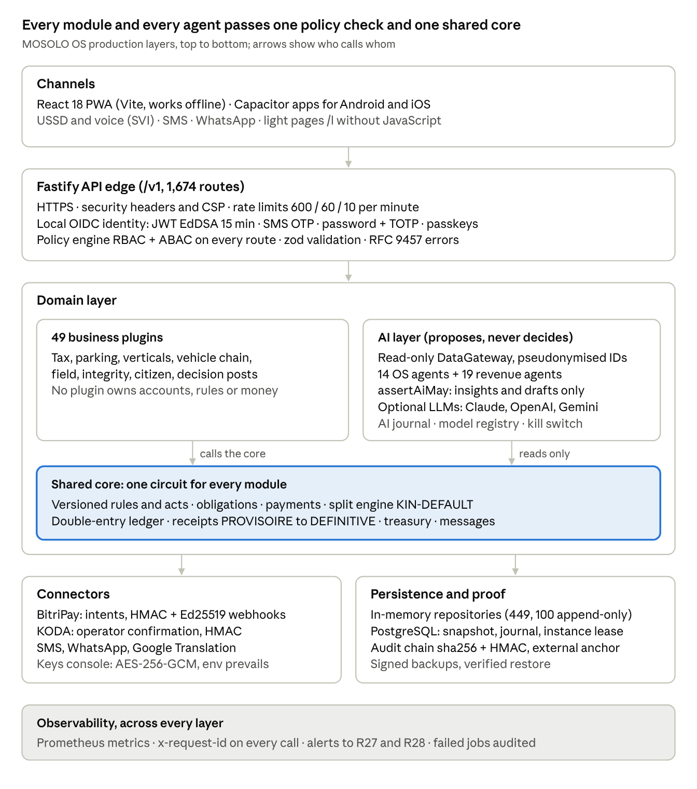
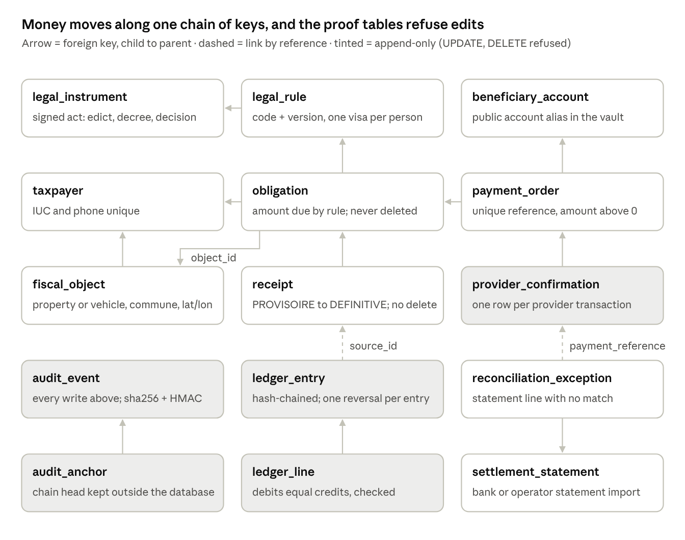
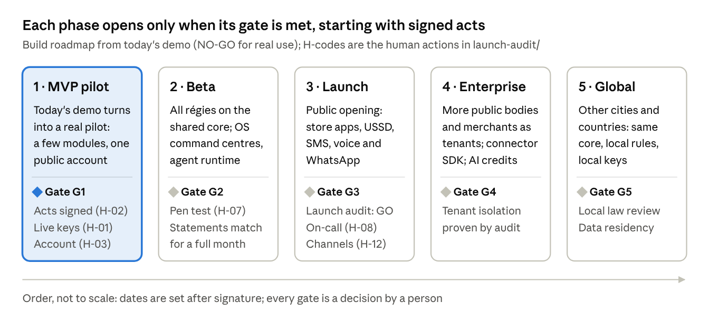

<!-- Copie figée (08/11/2026) du document de travail « MOSOLO AI Operating System — Developer Document » (Claude Docs, rév. 26).
     Conservée dans le dépôt pour qu'elle ne se perde pas ; les trois schémas dessinés sont joints en images (architecture.png, schema-donnees.png, feuille-de-route.png). -->

# MOSOLO AI Operating System — Developer Document

Oct 25, 2026 · @Justin

MOSOLO OS turns the existing KINSHASA MOSOLO revenue platform into an AI operating system: every user gets an AI command centre, a governed workforce of agents finds and secures revenue, and BitriPay becomes an installable payment door for any merchant or partner — built on code that already runs, with one rule kept everywhere: the AI proposes, a named person decides.

## Résumé exécutif (FR)

**La décision demandée.** Faire de KINSHASA MOSOLO le socle d'un système d'exploitation à agents d'IA (MOSOLO OS), sans rien retirer de ce qui existe : mêmes modules, mêmes circuits, mêmes contrôles, même grand livre. Le document décrit ce qui est déjà construit et ce qu'il faut ajouter, pour que l'équipe de développement puisse le bâtir.

**Ce qui existe déjà.** Une plateforme de recettes complète en démonstration : 49 modules, 1 674 routes d'API, 205 écrans, un moteur de paiement et de répartition unique (règle KIN-DEFAULT 70 / 10 / 10 / 10, versionnée, jamais codée en dur), des quittances PROVISOIRE puis DÉFINITIVE au rapprochement, une chaîne d'audit signée, 14 agents d'IA de la plateforme et 19 agents de recettes, et des fournisseurs d'IA externes facultatifs (Claude, OpenAI, Gemini) plafonnés.

**Ce que MOSOLO OS ajoute.**

1. Un **centre de commandement** par rôle, du Gouverneur à l'usager.
2. Un **moteur d'agents** : tâches, exécutions, outils, crédits d'IA par client.
3. La **porte BitriPay** installable chez tout marchand ou partenaire, sur le même moteur de règlement.
4. Un **kit de raccordement** pour les services tiers.
5. Le **multi-clients** (autres organismes publics, entreprises, autres villes).

**Ce qui ne change jamais.**

- L'IA propose, une personne décide.
- Aucune espèce pour les agents de terrain.
- Tout paiement va vers le compte public.
- Aucun taux inventé : toute valeur non confirmée est marquée « par défaut — à confirmer par le maître d'ouvrage ».

**Où en est-on.** L'audit de lancement du 24/10/2026 conclut **NO-GO pour un service réel** : la technique est prête pour un pilote, mais il manque des actions humaines.

- Les actes juridiques signés.
- Les clés de paiement réelles.
- Le compte public et ses relevés.
- L'hébergement de production.
- Un test d'intrusion indépendant.

**Calendrier par phases.** Pilote MVP → bêta → lancement public → entreprises → international. Chaque phase ne s'ouvre qu'à la levée de sa porte (section 15), décidée par une personne. Aucune date n'est promise avant la signature ; la date du « 30 octobre 2026 en service complet » est à corriger dans les envois officiels.

## Design principles and non-negotiables

MOSOLO OS automates everything that is reversible and evidence-based, and routes everything that touches money, rights or sanctions to a named person. The master prompt asked for a system that runs "without requiring human intervention"; that is applied to operations (monitoring, triage, drafting, routing, scaling, testing) and deliberately not to decisions, because the owner's standing rules forbid it and because every regulated operator that runs AI at scale (Stripe Radar, banks' AML engines, Palantir deployments) keeps a human on consequential actions.

| Prompt asks for | MOSOLO OS does | Why (rule or proof) |
| --- | --- | --- |
| Fully autonomous agents, no human intervention | Agents act alone only on reversible, low-risk actions (draft, score, route, remind, open a case); every action on money, rights, sanctions or access goes to a named person who records a reason | Owner rule: "L'IA propose, une personne décide ; aucune sanction automatique" (CLAUDE.md) |
| Auto-repair agent that patches and redeploys | Auto-repair opens a fix branch, runs the full gate, deploys to staging; production deploy and rollback need the release approver | Launch audit 24/10/2026: production deploys are irreversible actions needing human approval |
| "Military-grade", "hacker-impenetrable" security | Defence in depth, least privilege, zero trust, independent penetration test before launch; no absolute claims | No system is unbreakable; claims must be provable (launch-audit D-series) |
| Biometric authentication | Passkeys (device biometrics stay on the device), MFA, risk-based step-up; no biometric database | Biometrics closed by the owner; passkeys give the same assurance without storing biometrics |
| Dynamic pricing of taxes and fees | Tariffs only inside ranges fixed by a legal act (ParkSmart: 15–25 % free places); commercial SaaS prices are the only freely priced items | Owner rule: no invented rates; every amount rests on an ACTIVE rule with four approvals |
| Agents collecting payments | No agent ever touches cash; all payments go to the public account through BitriPay/KODA or approved payment points | Owner decision 29/09/2026 |
| Remove what is obsolete | Nothing is removed; old behaviour stays available, new layers are added on top | Owner Rule 1 (27/09/2026) |
| Profit maximisation | Revenue for the City first; Groupe Nseya paid on the verified surplus; taxpayers pay the exact amount owed | Approved surplus model; gateway fees borne by the City (30/09/2026) |

Five invariants every module, agent and API in this document must respect:

1. **Evidence before money.** A receipt is provisional until the bank statement reconciles it; a split is computed only on reconciled revenue.
2. **Separation of duties.** The proposer never approves; the super-administrator account never verifies, approves, activates or pays.
3. **Server-side truth.** Permissions, prices and amounts are decided on the server; the client only displays.
4. **Immutable history.** Corrections are reversal entries plus a corrected entry; the audit chain is hash-linked and anchored outside the database.
5. **Values marked honestly.** Any number not confirmed by the owner is labelled "par défaut — à confirmer"; demonstration data never reaches production.

## 1. Executive product vision

MOSOLO OS is the revenue operating system of a city-state economy: one identity, one ledger, one payment door and one governed AI workforce that together find every franc owed, collect it digitally, prove where it went and tell each decision-maker what to do next. Kinshasa is the first deployment; the same stack is built to be licensed to other cities, provinces and regulated collectors.

**The problem.** In Kinshasa most revenue that is owed never reaches the public account. The causes are structural, not technical: taxpayers no one has registered, cash handled by intermediaries, receipts that cannot be verified, separate tools per tax that never reconcile, and leaders who see last quarter's totals instead of today's gaps. Existing tools (the IRMS tax portal launched in March 2026, the Makuta-Karobase parking collection decided in July 2026) collect from those who come to pay; nobody systematically finds, verifies and follows up the rest.

**What MOSOLO OS is, in five layers:**

1. **Identity and assets** — one account per person or company; properties, vehicles, businesses and occupations linked by dated, verified relations.
2. **Rules and ledger** — every amount from a versioned legal rule; one double-entry ledger; one split engine (KIN-DEFAULT) for all 81 modules.
3. **Payment door** — BitriPay (routing: mobile money, card, QR) and KODA (operator confirmation) behind one gateway, extended into an installable door for merchants and partner platforms.
4. **AI workforce** — agents that discover the tax base, chase arrears, detect leaks and fraud, draft decisions and run operations, each with a scoped permission set and a human approver.
5. **Command centres** — one per user type, from the Governor's live commune map to the taxpayer's single "À faire" list.

**Why it is different.**

- **It verifies, not just collects.** A payment is final only when the bank statement matches; every receipt is publicly verifiable by QR. Competing portals treat a confirmation message as money received.
- **It goes looking.** Field agents with plate reading, geolocated evidence and offline memory, plus AI cross-checks of external sources, expand the base instead of waiting for declarations.
- **It removes the cash path.** No field agent can receive money — the server refuses it.
- **It is one system.** 16 sectors, one account, one ledger, one rule engine; existing platforms are connected, not replaced.
- **It is governed AI.** Every AI action is logged with its inputs, the model used and the human decision, so AI can be scaled without losing accountability.

**Why it can dominate.** Revenue platforms win on trust and integration, not features. MOSOLO OS compounds three assets a newcomer cannot copy quickly: a verified register of people and assets, a reconciled ledger history, and labelled decision data (every AI proposal with its human outcome) that makes each agent better for that city. The commercial model aligns incentives: the City keeps 100 % of today's revenue and Groupe Nseya is paid only on the verified surplus.

## 2. Market gap review

No existing category covers the full loop — find the payer, price from law, collect digitally, verify at the bank, split, prove publicly — and none governs AI agents inside that loop. Each competitor solves one segment.

| Category (examples) | What it does well | What it fails to solve | MOSOLO OS answer |
| --- | --- | --- | --- |
| National / provincial tax portals (Kinshasa IRMS, launched 5 March 2026) | Online declaration and payment of property tax, IRL, vignette, patente; bank reconciliation | Only reaches taxpayers who come forward; no field discovery; one tax family; no public verification of receipts | Connects to IRMS; field discovery, AI cross-checks and "À faire" bring the missing taxpayers in; QR-verifiable receipts for every line |
| Sector collection apps (Makuta-Karobase with APDNK, parking and moto-taxis, decision of 9 July 2026) | Digital collection for one sector | Single sector; no ledger shared with other revenue; no split engine; no Governor view | Connected as a sector source; its receipts flow into the single ledger and the commune map |
| ERP revenue suites (SAP Public Sector, Oracle Revenue Management) | Accounting depth, large-state deployments | Multi-year projects; desk-based; weak on mobile money, offline field work and cash removal; costly licences | Mobile-first, offline-capable, mobile-money native; deployed module by module in weeks |
| Payment gateways (Stripe, Flutterwave, BitriPay, KODA) | Moving money, signed webhooks, merchant tools | Know nothing about who owes what or why; no legal rule engine; no reconciliation to a public account | MOSOLO prices from the law and reconciles; BitriPay becomes MOSOLO's payment door rather than a separate tool |
| Analytics platforms (Palantir Foundry/Gotham, Snowflake + BI) | Data integration, decision dashboards | No transactional core: insights cannot become a payment, a notice or a field mission | Insight → proposal → human decision → action in the same system, with the audit trail |
| Agent frameworks (OpenAI Agents SDK, Anthropic Claude agents, Microsoft Copilot Studio) | Building agents quickly | No domain ledger, no regulated permissions, no separation of duties; agent actions are hard to audit | Agents run inside MOSOLO's policy engine: scoped permissions, human approval, decision log |

**Where users are underserved today:**

- **Taxpayers** do not know what they owe in total, pay intermediaries in cash, and cannot prove they paid.
- **Field agents** work on paper, are exposed to bribery and are paid irregularly.
- **Directors of revenue agencies** cannot see collection by commune, agent or sector before month-end.
- **The Governor** sees aggregated totals months late and cannot tell leakage from low activity.
- **Partners and merchants** (banks, operators, parking managers) integrate one-off with each agency.

**Where money is lost (the leak model used by MOSOLO's agents):** unregistered payers, under-declared bases, cash diverted before deposit, fake or reused receipts, unreconciled transfers, unpaid arrears never chased, and tariffs that no legal act supports (uncollectable when challenged). Each leak maps to an agent family in section 5 and to an indicator on the Governor's command centre.

**Proven patterns adopted (not invented):** split payments and connected accounts (Stripe Connect); signed, replay-protected webhooks with idempotency keys (Stripe, Adyen); ML feature store and model registry with offline evaluation (Uber Michelangelo, Databricks MLflow); a single metrics layer so every dashboard computes the same number (Airbnb Minerva); ontology linking objects, people and events (Palantir); chaos and failure-injection testing (Netflix); zero-trust access (Google BeyondCorp).

## 3. Complete user ecosystem

MOSOLO already defines 38 role codes in 10 families (`shared/src/domain.ts`); MOSOLO OS keeps them all and adds three external families for the payment door and developer ecosystem. One person has one account and may hold several compatible roles; incompatible pairs (for example R13/R14, R26/R17, any work role with R32) are refused by the server.

| Family | Roles (code — label) | Core job in the system |
| --- | --- | --- |
| Authorities | R01 Governor · R02 Chief of Staff · R03 Executive Secretary · R04 Provincial Minister · R05 Minister of Finance | Decide on proposals, set targets, approve contracts (R02) and amount access |
| Revenue agencies | R06 Director-General · R07 Head of service · R08 Entity administrator · R12 Counter agent | Run a revenue line: rules, campaigns, staff, counters |
| Treasury | R17 Public accountant · R18 Reconciliation analyst · R19 Beneficiary vault manager | Statements, reconciliation, exceptions, daily signed closure, settlement accounts |
| Legal | R13 Drafting lawyer · R14 Verifying lawyer · R15 Financial validator · R16 Publication authority · R20 Litigation agent · R21 Litigation decision authority | Four-approval rule circuit; appeals and disputes |
| Control | R11 Controller · R24 Anti-fraud investigator · R37 Quitus verification service | Field checks, fraud cases, quitus verification |
| Field | R09 Field supervisor · R10 Field agent · R35 Field subcontractor | Census, enrolment, controls, evidence, assisted digital payment (never cash) |
| Audit and privacy | R22 Internal auditor · R23 External auditor · R25 Data protection officer | Read-only audit, access reviews, dataset approval |
| Technical | R26 Super-administrator · R27 Operations engineer · R28 Security officer · R29 AI model manager | Keys, supervision, security, model registry and AI kill switch |
| Public | R30 Taxpayer · R31 Mandated representative · R36 Civil-society observer | Pay, prove, claim, contest; observe public statistics |
| Partners | R32 Approved payment point · R33 Bank / mobile-money partner · R34 Data partner · R38 Groupe Nseya (full read) | Collect cash at counters, settle, supply data, operate the platform (read, never write) |
| **New: Merchants** | M1 Merchant owner · M2 Merchant cashier · M3 Merchant developer | Collect public fees or their own sales through the BitriPay door (parking managers, event organisers, markets) |
| **New: Developers** | D1 Partner developer · D2 Partner admin | Build on the partner API with sandbox and live keys |
| **New: Regulators** | G1 Regulator observer (central bank, data protection authority, Court of Auditors) | Read compliance reports and audit extracts under a logged mandate |

**Account rules carried into every new family:** one person = one account; relations to assets are dated and verified, never inferred from a name or phone; nobody sees another person's earnings except R01, R02, R03, R05 and R38; merchant and developer accounts are tenants with their own keys and ledger sub-accounts, never access to taxpayer files.

## 4. AI command centres

Every user type gets one command centre built from the same seven assistants; what changes per user is the data scope, the actions allowed and the autonomy level, all enforced by the policy engine, not the interface. The assistants are thin roles over existing MOSOLO agents, so nothing is rebuilt.

**The seven assistants and what powers them today:**

| Assistant (prompt name) | MOSOLO engine underneath | Autonomy |
| --- | --- | --- |
| Chief of Staff (plan, prioritise, schedule, alert) | Decision-post inbox, "À faire", Monday note, DECISION\_EXECUTIVE agent | A: drafts and reminders |
| Analyst (reports, forecasts) | Single metrics layer (pilotage), PREVISION, PREVISION\_RECETTES | A: reports; never publishes |
| Research (market, competitor, opportunity) | DECOUVERTE, DECOUVERTE\_CROISEE, GRANDS\_CONTRATS, opportunities plugin | A: findings; B: opening a case |
| Automation (run workflows, delegate) | Jobs engine, MISSIONS\_TERRAIN, campaigns, reminders | A for reversible steps; C for money and rights |
| Growth (revenue, retention) | PRIORITE\_ARRIERES, ECHEANCIERS, RAPPELS, REGULARISATION | B: a human sends the campaign |
| Security (threat, fraud, anomaly) | FRAUDE, ANOMALIES\_TERRAIN, collusion detector (17 circuits), clone detection | A: alert and hold; C: any sanction |
| Knowledge (memory, learning) | AI memory (user 12/24 months, entity decisions 10 years), APPRENTISSAGE\_USAGER, apprentissage plugin | A |

Autonomy levels are the ones already in the AI OS (§ I.13): **A** reversible actions executed and undoable, switchable per entity; **B** executed only by the human who validates; **C** never executed by AI, routed to the maker-checker circuit. The kill switch belongs to R28 and R29.

**Command centre per user type:**

| User type | Data it sees | Actions it can take | Automations it controls | Decisions: recommended (R) / executed (E) |
| --- | --- | --- | --- | --- |
| Governor, Chief of Staff, Exec. Secretary (R01–R03) | All modules; commune map liquidated vs reconciled; alerts; earnings of all parties | Decide proposals with reason; set targets; approve amount access | Monday note; escalation of overdue exceptions | R: priorities, campaigns, tariff simulations · E: none without their click |
| Ministers (R04, R05) | Modules of their ministry and its agencies; R05 the full split engine | Same, within ministry | Ministry digest | R only |
| Revenue agency directors (R06–R08) | Their revenue line, agents, campaigns | Launch campaigns, assign missions, request rules | Reminder schedules, mission dispatch (A) | R: who to visit, which arrears first · E: reminders (A) |
| Treasury (R17–R19) | Statements, exceptions, suspense, settlements (amounts after approval) | Import statements (two-person), resolve exceptions, close the day | Auto-matching of statement lines (A, reversible) | R: match candidates · E: exact matches only |
| Legal (R13–R16, R20, R21) | Rules, acts, appeals | Draft, verify, validate, publish rules (four persons) | Legality watch | R: drafts flagged by GARDIEN\_LEGALITE · E: never |
| Field (R09–R11, R35) | Their attached modules and territory, "Autour de moi" without names or amounts | Control, scan, enrol, assisted digital payment | Offline memory, route plan (COPILOTE\_TERRAIN) | R: next best visit · E: hold a cloned credential (A, reviewed) |
| Anti-fraud and audit (R22–R25) | Cases, collusion signals, audit log | Open, investigate, propose decisions | Detectors run daily | R: case priority · E: conservative hold only (A) |
| Taxpayer, representative (R30, R31) | Own obligations, receipts, proofs, properties, grievances | Pay, claim a property, contest, present proofs | Payment reminders they opt into | R: instalment plan suggestion · E: none |
| Payment points, banks (R32, R33) | Their collections, cash days, deposits | Record collection, close day, deposit | Late-deposit suspension (automatic, owner decision) | E: conservative suspension; lifting by a person |
| Merchants, developers (new) | Their transactions, keys, webhooks, settlements | Create links/QR, refund within policy, rotate keys | Webhook retries, settlement reports | R: fraud score on a payment · E: hold above threshold (to confirm) |
| Groupe Nseya (R38) | Read: split engine, ledger, aggregated treasury, audit, supervision | Read and export only | Cost and health monitoring | R only; never writes |

**Build rule:** a command centre is a layout of widgets fed by `/v1/command-centre/{role}` (section 11); each widget declares its data scope and the policy action it needs, so adding a user type is configuration, not code.

## 5. Core AI agents

The 15 agents requested map onto 33 agents that already exist (14 in the AI OS catalogue, 19 revenue agents) plus four new ones; every agent runs under one contract, so a new agent is a declaration, not a new subsystem.

**Agent contract (applies to every agent):**

1. **Control sheet** — code, purpose, data domains it may read, policy actions it may request, autonomy level (A/B/C), owner role, kill switch.
2. **Data access** through the read-only `DataGateway` with pseudonymised identifiers; reading outside the sheet fails with `IA_DATA_DOMAIN_FORBIDDEN`.
3. **Output** in the eight fixed fields of the AI OS catalogue (plugins/ia/catalogue.ts), always naming the responsible human role.
4. **AI guard** — an AI principal may only produce `ai.insight` and `draft.write`; the ten forbidden actions (create a tax, impose a penalty, determine ownership, seize property, suspend a right, approve an exemption, close an appeal, transfer money, change a beneficiary, destroy audit) are refused in code.
5. **Journal** (append-only): purpose, model version, prompt hash, data hash, masked fields, citations, output hash, then the human decision and reason.
6. **Model** — rules engine by default; external LLM (Claude → OpenAI → Gemini relay) only if a key exists, on redacted content, within the daily cap.
7. **Evaluation gate** — a new model version is promoted by two people after offline evaluation and a bias test in the model registry.

**The 15 core agents:**

| Agent | Built on (existing code) | Inputs | Outputs | Permission / autonomy | Triggers | Escalates to | Business value |
| --- | --- | --- | --- | --- | --- | --- | --- |
| Onboarding | ENROLEMENT, APPRENTISSAGE\_USAGER | Registration, field enrolment batches, claims | Completion checklist, next step, duplicate warning | draft.write · A | New account, abandoned step > 24 h | R08 entity admin | More taxpayers finish registration |
| Compliance | GARDIEN\_LEGALITE, VEILLE\_JURIDIQUE + **new KYC/KYB** | Rules, acts, merchant documents | Legality flags, missing-act list, KYB verdict proposal | ai.insight · C | Rule draft, merchant application | R14 / R25 | No uncollectable amount; clean merchant base |
| Risk | FRAUDE, EQUITE | Payments, controls, proposals | Risk score per case, equity ratio (> 1.5 flagged) | ai.insight · A (score) | Every proposal batch | R24 | Fair, defensible enforcement |
| Revenue | PRIORITE\_ARRIERES, REGULARISATION | Obligations, arrears, payment history | Ranked arrears list, amnesty-window simulation | ai.insight · B | Daily | R06 | Arrears recovered, largest first |
| Pricing | IMPACT\_TARIF, PRIX\_STATIONNEMENT | Rules, occupancy, payment elasticity | Tariff impact by commune rank; parking price within act range | draft.write · C (tariffs) / A (parking within range) | Tariff proposal; occupancy outside 15–25 % free | R05 / R06 | Revenue without unfair burden |
| Customer support | COPILOTE, DOLEANCES, VOCAL\_USSD | Questions, grievances (redacted) | Answer draft, triage category, urgency | draft.write · A (answer), B (send) | New grievance or question | R07 | Grievances answered within 15 days |
| Marketing | RAPPELS, OU\_VA\_ARGENT, COMMUNICATION | Due dates, consent, commune results | Personalised reminder drafts, transparency stories | draft.write · B | Due date − 15/−3 days | R07 | Voluntary payment up |
| Data intelligence | PREVISION, PREVISION\_RECETTES, HUMEUR | Ledger, reconciled revenue, grievances | Forecasts with intervals, dissatisfaction barometer | ai.insight · A | Weekly; on demand | R05 | Budget credibility |
| Operations | MISSIONS\_TERRAIN, COPILOTE\_TERRAIN, ALLOCATION | Territory, agents, open cases | Route plan, mission assignment proposal | draft.write · B | Daily 06:00 | R09 | More productive field days |
| Fraud detection | FRAUDE, ANOMALIES\_TERRAIN, VERIFICATION\_PUBLIQUE, collusion detector | Scans, receipts, agent patterns | Clone alerts, collusion signals, fake-receipt hits | ai.insight · A (conservative hold) | Every scan; daily sweep | R24 | Leakage closed at source |
| Payment | RAPPROCHEMENT | Confirmations, statement lines | Match candidates, exception queue | ai.insight · A (exact match only) | Statement import, webhook | R18 | Faster final receipts |
| API integration (**new**) | Partner API, keys console, connector registry | Partner calls, webhook failures, provider status | Integration health, misconfiguration diagnosis, retry plan | ai.insight · A (retry) | Webhook failure, test failure | R27 | Partners onboard without engineers |
| Workflow automation (**new**) | Jobs engine, campaigns, drafts | Workflow definitions | Executed reversible steps, audit entries | draft.write · A only | Schedules, events | Workflow owner | Repetitive work removed |
| Predictive growth | PREVISION\_RECETTES, DECOUVERTE\_CROISEE | Register, external imports (validated), ledger | Base-expansion targets by commune | ai.insight · A | Monthly | R06 / R05 | Base grows, not rates |
| Admin control (**new**) | Model registry, AI journal, kill switch | Agent metrics, drift, bias, costs | Drift and bias alerts, suspension proposal | ai.insight · C | Drift > 20 points over 30 days (≥ 10 decisions, to confirm) | R29 / R28 | AI stays trustworthy |

**Platform self-management agents (operations only, never decisions about people):**

| Agent | Does automatically | Needs a person for |
| --- | --- | --- |
| System health | Watches availability, p95 latency, error rate; raises one alert per window to R27/R28 | Paging an on-call person (channel to set up, H-08) |
| Bug detection | Runs the test suite, route crawl and link sweep on every commit; files defects | Prioritising fixes |
| Auto-repair | Opens a fix branch, runs the full gate, deploys to staging | Approving production deploy and rollback |
| Infrastructure optimisation | Reports idle resources and cost per request (e.g. always-on database with no traffic) | Stopping or resizing anything |
| Release management | Builds, tags, runs smoke tests, prepares rollback | Releasing to production |
| AI governance | Enforces control sheets, caps, redaction; computes drift and bias | Promoting a model; lifting a kill switch |

The executive, product, engineering and quality agents listed in the master prompt (CEO, CTO, frontend, QA…) are development-time assistants, not runtime agents: they work on the repository through the same gate (typecheck, lint, tests, build) and never hold production permissions.

## 6. Platform modules

MOSOLO already ships 49 backend plugins, 1,674 API routes and 205 screens; MOSOLO OS keeps every one and adds seven modules (marked **New**) for command centres, the merchant and developer doors, AI billing and the agent workforce. Plugins share one account, one rule engine and one payment circuit: no module may create its own.

**Existing module families (kept as they are):**

| Family | Plugins | Routes | Screens | What it does |
| --- | --- | --- | --- | --- |
| Access and identity | acces, acces-montants | 94 | 15 | Accounts, entities, invitations, mandates, roles, amount-access approvals |
| Tax | fiscal | 111 | 16 | Properties, relations, declarations, exemptions, quitus, map |
| Treasury | tresor, tresor-releves | 43 | 2 | Statements, three-way reconciliation, exceptions, daily signed closure |
| Collections | recouvrement, campagnes | 75 | 8 | Notices, reminders, arrears, campaigns |
| Credentials and transport | titres, rakapay | 79 | 6 | Tickets and passes (animated QR), RakaPay, wewa |
| Parking and advertising | parking, publicite | 126 | 17 | ParkSmart sessions and controls, KIN PUB CONTROL |
| Sector verticals | verticales, grands-redevables | 194 | 10 | 16 sectors (markets, events, construction, telecoms, AVIA, NFIU plates, CALCU) |
| Vehicle chain | vehicules-controle | 85 | 8 | Technical inspection, accredited centres, pounds |
| Channels | canaux | 46 | 9 | USSD, voice, assisted enrolment, payment points, MOSOLO card |
| Field | terrain, apprentissage, equipements | 93 | 13 | Missions, plate OCR, evidence camera, devices, training |
| Integrity | integrite (5), sanctions | 98 | 13 | Reports, investigations, collusion detector, mystery checks |
| Pilotage and split | pilotage family (7 plugins) | 172 | 28 | Indicators, commune scale, KIN-DEFAULT split engine, planning |
| Decision posts | decision, postes | 59 | 11 | Governor command centre, decision inbox, work posts |
| AI | ia, ia-modeles, opportunites, agents-recettes | 92 | 10 | AI OS, model registry, revenue agents |
| Proofs and documents | preuves, communication, documents | 45 | 7 | Universal proof resolver, messaging, branded documents |
| Citizen | citoyen | 60 | 11 | "Mon espace", À faire, proofs, grievances |
| Platform | plateforme, catalogue-api, socle, referentiel, juridique, chaine | 93 | 17 | Supervision, partner API, identity provider, keys console, legal register |

**New modules for MOSOLO OS:**

| Module | Purpose | Main screens | Depends on |
| --- | --- | --- | --- |
| Command centre framework (**New**) | Role-scoped widget layouts over existing data (section 4) | /centre (one per role), widget catalogue for admins | Policy engine, metrics layer, AI inbox |
| Agent workforce console (**New**) | One place to see every agent: sheet, autonomy, runs, journal, cost, kill switch | /agents, /agents/:code | AI OS, model registry |
| Merchant portal (**New**) | Onboard merchants (KYB), payment links, QR, refunds within policy, settlements | /marchands, /marchands/:id/paiements, /reglements | Payment door (section 7), KYB connector |
| Developer centre (**New**) | Sandbox and live keys, webhook endpoints and logs, API reference, test tools | /developpeurs, /developpeurs/cles, /webhooks | Partner API, keys service |
| AI billing and ACU metering (**New**) | Meter every external AI call, cost centre, monthly invoice of costs + 5 % | /facturation/ia | ia-fournisseurs audit events |
| Workflow builder (**New**) | Declarative reversible workflows (trigger → steps → approval) | /workflows | Jobs engine, drafts, approvals |
| Regulator room (**New**) | Read-only compliance packs for central bank, data protection authority, auditors | /regulateurs | Audit log, transparency, consultation log |

**Cross-cutting modules every screen relies on** (already built): user accounts and single account, notifications (in-app always; SMS, email, WhatsApp, push when keys exist), reporting and exports (bulk exports above a threshold need two approvals), transaction ledger and receipts, commissions and field pool, audit trail (hash-chained), security (MFA, passkeys, rate limits), translation (French prevails).

## 7. BitriPay payment gateway door

The BitriPay connector already moves MOSOLO's own payments with signed webhooks and idempotency; MOSOLO OS wraps it in a door that merchants, partners and external platforms install themselves — keys, sandbox, webhooks, links, QR and settlement — while money always settles to the account the merchant's contract names and MOSOLO never holds funds.

**What exists today (connector `payments/connectors/bitripay.ts`):**

| Capability | Implementation |
| --- | --- |
| Payment intent | POST /payment\_intents (amount in minor units, currency, allowed operators orange\_cd, mpesa\_cd, airtel\_cd, africell\_cd; card and QR BitriPay rails); GET, cancel, timeline |
| Idempotency | Idempotency-Key = payment reference on every money-moving POST |
| Webhook security | BitriPay-Signature HMAC-SHA256 over timestamp.body (± 5 min) + BitriPay-Signature-Ed25519 against a pinned key, required once a key is set; constant-time comparison; replay guard on event IDs |
| Extra confirmation | GET /payment\_resolution server-to-server before any receipt; ambiguous\_hold never yields a receipt |
| Fees | application\_fee\_minor never sent: the payer pays the exact amount; gateway fees invoiced to the City separately |
| Sandbox | Local sandbox without keys; test numbers +243000000501 success, …404 failure, …408 ambiguous, …500 late success, …503 provider down; simulated gateway refused once a real key exists |
| Settlement | Settlement alias must exist in the vault (default KIN-DGIPK-RECETTES-01), one alias per revenue agency |
| Keys | Entered in the super-administrator's console, encrypted, kept across restarts, hot-reloaded; provider URL restricted to bitripay.com |

**The door (new), in the order a merchant meets it:**

1. **Merchant onboarding** — application with RCCM, NIF, beneficial owners, settlement account; KYB connector checks; Compliance agent proposes, R33 or the door owner approves; status SANDBOX → REVIEW → LIVE → SUSPENDED.
2. **API key generation** — per merchant and environment: publishable `pk_` (browser, create intents only), secret `sk_` (server), restricted `rk_` (scoped). Shown once, stored as a hash plus encrypted value, rotation with overlap of 24 h (to confirm), last-used date displayed.
3. **Sandbox and live modes** — separate keys, ledgers and webhook endpoints; sandbox uses BitriPay's test numbers; live requires LIVE status and a passed test payment.
4. **Webhooks** — merchant registers HTTPS endpoints per event type; MOSOLO signs outbound events with the same scheme it verifies inbound (timestamped HMAC + Ed25519), retries with backoff (10 s, 30 s, 2 min, 10 min, 30 min, then every 2 h for 24 h, as BitriPay does), and shows delivery logs and a replay button.
5. **Payment methods** — QR (static per point of sale, dynamic per amount), payment links (single and reusable, with expiry), wallet and mobile money (four operators, chosen in one tap), card (hosted by BitriPay, so MOSOLO stays out of PCI cardholder scope), bank transfer (reference-matched on the statement).
6. **Settlement** — BitriPay settles directly to the account named in the merchant contract; MOSOLO's ledger records the expected settlement and reconciles it against the statement; settlement report per day with fees shown separately.
7. **Refunds** — full or partial, only to the original instrument, within the merchant's refund policy, idempotent, two-person approval above a threshold (to confirm).
8. **Disputes** — dispute record with evidence upload and deadline; provider dispute API to be confirmed with BitriPay (H-01); the existing split-engine dispute flow (litiges) handles disputed allocations.
9. **Commission split** — computed by the MOSOLO split engine on reconciled amounts (never deducted at the gateway): for public revenue, rule KIN-DEFAULT; for merchants, the commercial share agreed with BitriPay.
10. **Transaction monitoring** — Fraud agent scores each payment (velocity, device, amount pattern, operator mismatch); holds above threshold go to R24; AML screening before first payout.
11. **Developer documentation and plugins** — OpenAPI reference, quick-start in five languages (cURL, JavaScript, PHP, Python, Java), Postman collection, test cards and numbers, and ready plugins for WooCommerce and a generic JavaScript checkout.

**Plugin-ready integration logic:** a merchant site needs three calls — create intent with its secret key, redirect or show QR, receive the signed webhook — and one check: confirm by GET before delivering goods. The door enforces the same order MOSOLO uses for public revenue, so every merchant inherits signature checking, idempotency and verified receipts.

## 8. Third-party API connectors

Every external service plugs into one connector framework already used for payments: a typed adapter, variables declared in the keys console inventory, signed inbound webhooks, a "Tester" button, a sandbox mode and hot reload — so adding a provider never touches business modules. **Live** = raccordé in code today; **Add** = new adapter.

| Category | Why needed | Connects to | Sends / receives | Provider options | Status |
| --- | --- | --- | --- | --- | --- |
| Payments (routing) | Collect mobile money, card, QR | Payment orders, door | Intent, amount, operator / status, signed webhook | BitriPay | Live (keys pending) |
| Payments (verification) | Confirm operator payments | Payment orders | Reference / verified confirmation | KODA | Live (keys pending) |
| Payments (international) | Diaspora and foreign merchants | Door | Card intents / webhooks | Stripe, Adyen, Checkout.com, PayPal | Add (phase 4) |
| Banking / BaaS | Public account statements, payouts | Treasury, split engine | Statement files or API / credit lines; payout orders | Partner banks (Rawbank, Equity BCDC, TMB — to confirm), SWIFT MT940/camt.053 | Partly (statement import live; API add) |
| Open banking | Merchant settlement checks | Door settlement | Account balance and transactions | Bank APIs where available | Add |
| KYC / KYB | Merchants, partners, subcontractors | Door onboarding, field subcontractors | Documents, selfie (deleted after check) / verdict | Smile ID (Africa coverage), Sumsub, Veriff, Persona | Add |
| AML screening | Payouts, merchants | Split engine payouts, door | Name, date of birth / PEP and sanctions hits | ComplyAdvantage, Sumsub, Refinitiv World-Check | Add |
| Fraud prevention | Card and device risk | Door, payment orders | Device signals / score | Provider-side (BitriPay), Sift, SEON | Add |
| Identity / NIF | Verify tax number and ID | Single account | NIF / validity | DGI / national registry API (MOSOLO\_NIF\_API\_\*) | Variables reserved, adapter add |
| Email | Notices, receipts | Communications | Template + variables / delivery status | SendGrid, Brevo, Amazon SES | Queue ready; adapter add |
| SMS | Reminders, "V code" verification, OTP | Communications, proofs | Message / delivery, inbound SMS (signed) | Operators' aggregators, Twilio, Africa's Talking | Inbound live; outbound adapter add (H-12) |
| USSD | Feature-phone payment and balance | Channels | Session events / screens | Operator USSD gateway, Africa's Talking | Engine live; short code pending |
| WhatsApp | Proofs, reminders with consent | Proofs, communications | Template messages / inbound (signed) | Meta WhatsApp Business Platform (via Twilio or 360dialog) | Webhook live; business account pending |
| Push notifications | App reminders | Communications | Device token, message | Firebase Cloud Messaging, Apple Push | Add |
| Maps | Census, geolocation, "Autour de moi" | Field, tax map | Tiles | Self-hosted OpenStreetMap tiles (no per-view cost) | Live |
| Logistics | Pound transport, document delivery | Vehicle chain, documents | Pickup / tracking | Local couriers via API (to identify) | Add (phase 4) |
| Accounting | Export the ledger to the public accounting system | Ledger | Journal entries / acknowledgement | Provincial accounting system format; Sage, Odoo for partners | Export live; connector add |
| Tax (national) | Exchange with DGI for shared taxpayers | Tax module | Taxpayer IDs / status | DGI API (to negotiate) | Add |
| CRM | Partner and merchant relationship | Door, partner API | Account, pipeline | HubSpot, Salesforce | Add (phase 4) |
| Analytics | Product analytics without personal data | Frontend | Page events (pseudonymous) | Self-hosted PostHog or Plausible | Add |
| AI model providers | Optional reasoning for agents | ia-fournisseurs | Redacted aggregates / text | Anthropic Claude, OpenAI, Google Gemini (live); Vertex AI, Mistral, Cohere (add) | Live (keys optional) |
| Translation | Five local languages + English | Whole UI | Interface strings / translations | Google Cloud Translation | Live (D-15: send catalogue strings only) |
| Cloud storage | Evidence photos, documents, backups, console file | Documents, backups | Encrypted objects | Google Cloud Storage (live), Cloudflare R2, Amazon S3 | Live on GCS |
| Authentication (external) | Government SSO for civil servants | Identity provider | OIDC tokens | National identity provider when available (MOSOLO\_OIDC\_ISSUER) | Ready (local IdP today) |
| Document generation | Notices, receipts, cards | Documents | Template / signed PDF | In-house PDF with Ed25519 signature | Live |
| E-signature | Contracts, conventions, acts | Legal register | Document / signed envelope | DocuSign, Yousign (qualified where required) | Add |
| Time-stamping | Legal proof of time | Integrity | Hash / RFC 3161 token | Qualified TSA (MOSOLO\_TSA\_\*) | Variables ready |
| Customer support | Ticketing beyond grievances | Citizen, door | Ticket / status | Zendesk, Freshdesk or in-house grievances (live) | In-house live |
| Data enrichment | Base discovery | DECOUVERTE\_CROISEE | Anonymised batches (SNEL, REGIDESO, imagery, operators) | Utility and operator exports, satellite imagery | Batch import live (two-person validation) |
| Currency exchange | CDF/USD conversion | Payments, treasury | Daily rate | Banque Centrale du Congo official rate (signed import) | Blocked (H-04, D-16) |
| Subscription billing | Merchant and partner plans, ACU | AI billing, door | Plan, usage / invoice | In-house on the ledger (Stripe Billing for international) | Add |

**Rule for every connector:** no personal data leaves unless the purpose is recorded and the data is minimised; every call is logged without content; every inbound callback is signed and replay-protected; every provider has a sandbox path tested in CI.

## 9. Production-grade architecture

MOSOLO OS keeps MOSOLO's architecture and adds to it; nothing is replaced. Requests come in through the channels, pass one API edge where identity and the policy engine are checked, reach a business plugin or an AI agent, and every money or legal effect goes through the shared core. Built parts run today; parts marked **Add** are MOSOLO OS work.



The AI layer only reads (through the DataGateway) and writes drafts or proposals; a person turns a proposal into an action through the same circuits as any other user.

| Layer | Built today | Add for MOSOLO OS |
| --- | --- | --- |
| Channels | React 18 + Vite PWA with offline cover; Capacitor 6 Android and iOS shell; USSD and voice sessions (182-character screens, PIN as scrypt hash); WhatsApp, SMS "V + code", light pages `/l` without JavaScript | Command-centre shell per role (section 4); store-published apps (H-13) |
| API edge | Fastify 5.12.7, versioned `/v1`, zod validation, RFC 9457 errors, `x-request-id`, CSP `script-src 'self'`, sliding-window limits 600 / 60 / 10 per minute | `/v1/os/*` surface for agents, tasks and command centres, under the same policy engine |
| Identity | Local OIDC provider (`urn:mosolo:idp:local`), JWT EdDSA 15 min bound to a revocable session, SMS OTP for taxpayers, scrypt + TOTP for work accounts, WebAuthn passkeys, optional mTLS for partners and terminals | External OIDC federation for enterprise tenants |
| Policy | RBAC + ABAC (entity, territory, own record), separation of duties, closed action list, `module:action` extensions denied unless declared, `assertAiMay` | Tenant attribute in every decision; agent principals as first-class subjects |
| Domain | 49 plugins (`MosoloPlugin { name; create; seed?; routes? }`), access through `ext(ctx, name)`; no plugin has its own account, rules or payment circuit | New OS plugins (section 6) built on the same interface |
| AI | 14 deterministic OS agents, 19 revenue agents, DataGateway, AI journal, memory levels, model registry, LLM relay Claude → OpenAI → Gemini with redaction and caps | Agent runtime with task queue, tool registry and per-tenant AI credit metering (section 12) |
| Core | Versioned rules, obligations, payment orders, split engine KIN-DEFAULT, double-entry ledger, receipts, treasury, three-way reconciliation, messages, integrations | Multi-tenant ledgers (one per public body or merchant), same invariants |
| Connectors | BitriPay, KODA, HMAC v2 callbacks, SMS, WhatsApp, Google Cloud Translation, keys console | Connector SDK (section 8) |
| Persistence | In-memory repositories with PostgreSQL snapshot, append-only journal (trigger refuses UPDATE and DELETE), instance lease with fencing (503 for a superseded instance) | Relational adapter on `backend/db/schema.sql` (section 10), read replicas |
| Proof | Audit chain sha256 + HMAC, external anchor, signed backups with per-repository manifest, restore refused on any failed check | Timestamping authority (TSA) and WORM copy in service (H-06) |
| Observability | Prometheus `GET /v1/plateforme/metrics` (token), alerts on availability, p95 latency and errors to R27 and R28, `system.job.failed` | Per-agent cost and latency dashboards; on-call rota (H-08) |

**Deployment.** One Docker image (`node:22-bookworm-slim`, build then basemap then runtime, `USER node`, port 8080). The demo runs on Cloud Run (`mosolo-demo`, one instance) or on the owner's VPS (`infra/vps/demo`). Production kits exist for Google Cloud (`infra/gcp`: Cloud Run, Cloud SQL PostgreSQL 16 with PITR, Secret Manager, daily signed backups) and for a VPS (`infra/vps`: app read-only, PostgreSQL 16, Caddy, daily backup); neither has been run in production yet. CI runs the route check, typecheck, lint, tests, build and `npm audit`, plus a PostgreSQL job that tests backup, append-only refusal and restore.

**Scaling path.** The current design runs one writing instance (the lease makes sure of it). MOSOLO OS scales in three steps: (1) move reads and writes to the relational adapter so several instances can run; (2) run agents and connectors as separate workers that consume the journal; (3) give each tenant its own schema or database when a contract requires it. Each step keeps the same repository interfaces, so business code does not change.

## 10. Database schema

Two layers exist today. **Running:** 449 in-memory repositories (100 of them append-only), saved to PostgreSQL as one JSONB snapshot per repository (`repository_snapshot`), an append-only journal (`append_only_journal`, a trigger refuses UPDATE and DELETE) and a write lease (`instance_lease`). **Reference schema:** `backend/db/schema.sql`, 32 relational tables in schema `mosolo`, which the relational adapter will implement behind the same `Repository<T>` and `AppendOnlyRepository<T>` interfaces. MOSOLO OS builds on the reference schema; it removes no table.



The chain reads left to right and top to bottom: a signed act gives a versioned rule, a rule creates an obligation for a taxpayer and an object, a payment order is raised against the obligation and points to a public account, the provider's confirmation gives a provisional receipt, and the ledger and the bank statement close the loop.

**Types and money.** Amounts are `money_amount` = `NUMERIC(24, 6)` with a separate `currency_code` (ISO 4217, `CHAR(3)`); never a float. Identifiers are `TEXT`. Timestamps are `TIMESTAMPTZ`. Locations are `lat` / `lon` `NUMERIC(9,6)` today; a PostGIS geometry column is an **Add** for map queries.

| Group | Tables (reference schema) | Key constraints |
| --- | --- | --- |
| Identity and roles | `app_user`, `user_role` | One role row per grant; incompatible role pairs checked by the service and a periodic integrity check |
| Taxpayers and objects | `taxpayer`, `fiscal_object`, `lease` | `taxpayer.iuc` and `phone` unique; `language` in fr, ln, sw, kg, lua, en; object `status` PROVISOIRE or VALIDE; indexes on object taxpayer and commune |
| Field | `field_observation`, `field_conflict`, `device` | `field_observation` append-only |
| Legal basis | `legal_instrument`, `legal_rule`, `legal_rule_instrument`, `legal_rule_approval` | `UNIQUE (code, version)`; `UNIQUE (rule_id, user_id)` = one visa per person; approvals append-only |
| Obligations | `obligation` | Delete refused by trigger; `supersedes` / `superseded_by` for corrections; index on `attribution_commune` |
| Public accounts | `beneficiary_account`, `beneficiary_change_request`, `beneficiary_change_approval` | Changes need approvals by distinct persons; approvals append-only |
| Payments | `payment_order`, `idempotency_key`, `provider_nonce`, `provider_confirmation` | `payment_reference` unique; `amount > 0`; idempotency key primary key `(scope, key)`; `UNIQUE (provider, provider_txn_id)` stops replays; confirmations append-only |
| Receipts | `receipt` | `number`, `code` and `payment_order_id` unique; delete refused |
| Reconciliation and ledger | `settlement_statement`, `reconciliation_exception`, `ledger_entry`, `ledger_line` | Ledger append-only and hash-chained; `reversal_of` unique = one counter-entry per original; a deferred constraint trigger checks each entry balances |
| Appeals, messages, drafts | `appeal`, `delivery`, `draft_version` | Deliveries and draft versions append-only |
| AI and security | `ai_recommendation`, `security_alert` | Autonomy in A\_AUTO, B\_VALIDATION, C\_RECOMMANDATION; status EMISE, ACCEPTEE, MODIFIEE, REJETEE; decision by a named user with a reason; alerts append-only |
| Proof | `audit_event`, `audit_anchor` | `hash` unique; UPDATE, DELETE and TRUNCATE refused; indexes on `action` and `resource_id`; anchor append-only |

**Permissions.** The application role `mosolo_app` has no UPDATE, DELETE or TRUNCATE on `audit_event`, `ledger_entry`, `ledger_line`, `delivery` and `provider_confirmation`; the trigger `forbid_mutation()` refuses the change even for the owner. Row-level reads are decided in the policy engine, not in SQL, so one rule set covers memory and database.

**Tables MOSOLO OS adds** (same conventions: `TEXT` ids, `TIMESTAMPTZ`, money as `money_amount` + `currency_code`, a `tenant_id` on every row):

| Table | Purpose | Rules |
| --- | --- | --- |
| `tenant` | A public body, régie or enterprise customer | Every other new row carries `tenant_id`; reads filtered by the policy engine |
| `agent_definition` | One row per agent and version: control sheet, data domains, autonomy ceiling | Promotion by two distinct persons, as in the model registry |
| `agent_task` | A unit of work given to an agent (who asked, scope, deadline, status) | Status moves forward only; cancelled tasks keep their history |
| `agent_run` | One execution: model version, prompt hash, data hash, output hash, cost | Append-only; mirrors the AI journal entry |
| `tool_call` | Each tool an agent called, with arguments hash and result code | Append-only; a forbidden action is recorded as DENIED, never run |
| `ai_credit_ledger` | AI credits bought, used and refunded per tenant | Double-entry and append-only, like `ledger_entry` |
| `connector_install` | A connector enabled for a tenant, its scopes and key reference (never the key) | Keys stay in the keys console or a secret manager |
| `command_centre_layout` | Saved layout of a role's command centre | Per user; no business data |

**Retention.** Kept as decided in MOSOLO: user memory 12 / 24 months, entity decisions 10 years, pseudonymised intelligence 36 months; signed backups 30 days on Google Cloud. Retention periods for the new OS tables are **par défaut — à confirmer par le maître d'ouvrage**.

## 11. API specification

One API, versioned under `/v1`, serves the web app, the mobile shell, the channels, partners and AI agents. Today it has 1,674 routes in 53 modules, listed by `tools/gen_routes.py` in `specs/routes-api.md` (CI fails if the list is stale); contracts are in `specs/openapi.yaml` and `specs/contrat-api.md`. MOSOLO OS adds routes under the same rules; it removes none.

**Rules every route follows**

| Rule | How it works today |
| --- | --- |
| Authentication | `Authorization: Bearer <JWT EdDSA>` from the local OIDC provider (`/.well-known/openid-configuration`, `jwks.json`); 15-minute token bound to a revocable session. Partners use OAuth2 client credentials at `/v1/oauth/token` with scoped tokens and optional mTLS |
| Authorisation | The policy engine is called on every route (RBAC + ABAC, separation of duties); an AI principal is limited to `ai.insight` and `draft.write` |
| Validation | zod schemas, `.strict()` on write bodies; failure = 400 `VALIDATION_ERROR` |
| Errors | RFC 9457 `application/problem+json` with a stable `code` (for example `CASH_NOT_ALLOWED_FOR_AGENT`, `MODULE_NON_RATTACHE`, `IA_LIMITE`) |
| Idempotency | Money-moving POSTs require `Idempotency-Key`: missing = 400 `IDEMPOTENCY_KEY_REQUIRED`; same key, different body = 409 `IDEMPOTENCY_KEY_REUSED`; a replay returns the first answer with header `idempotent-replayed: true` |
| Rate limits | 600 per minute global, 60 public, 10 on authentication; 429 with `Retry-After` and `RateLimit-*` headers |
| Tracing | `x-request-id` accepted or generated, returned and written to the audit event |

**Example: create a payment order** (existing route)

```http
POST /v1/obligations/{obligationId}/payment-orders
Authorization: Bearer <token>
Idempotency-Key: <unique key chosen by the client>
Content-Type: application/json

{ "channel": "MOBILE_MONEY", "provider": "bitripay", "operateur": "orange_cd" }
```

`channel` is one of MOBILE\_MONEY, BANK, CARD, AGENT\_POINT, USSD, QR, TRANSFER; `provider` (bitripay or koda) only for a gateway; `operateur` one of orange\_cd, mpesa\_cd, airtel\_cd, africell\_cd, and only with a provider (else 422 `OPERATOR_WITHOUT_PROVIDER`); `installmentPlanId` takes the next instalment from an agreed plan. The amount is never sent by the client: it is read from the obligation. Answer 201 with the order and its payment reference.

**Existing route families** (examples, not the full list)

| Family | Routes |
| --- | --- |
| Payments | `/v1/obligations/:id/payment-orders`, `/v1/payment-orders/:reference/{status, changer-moyen, provider-resolution, provider-verification-evidence}`, `/v1/providers/{connectors, readiness}`, `/v1/providers/:p/{test-connection, sandbox-simulate, callbacks}` |
| Inbound webhooks | `/v1/providers/bitripay/webhooks` (HMAC + Ed25519), `/v1/providers/koda/webhooks` (HMAC), `/v1/sms/inbound`, `/v1/whatsapp/webhook` |
| Public (no account) | 56 paths under `/v1/public/*`: receipt and proof checks, payment points, integrity reports, transparency, `ou-va-votre-argent` |
| AI | `/v1/ia/{agents, agents/:code/run, sweep, inbox, recommendations/:id/decide, journal, memory/*}`, `/v1/agents-recettes*`, `/v1/ai/insights` |
| Partners | `/v1/partenaires/api/v1/{quittances/:n, paiements/:ref, statistiques, abonnements}`: no personal data; quotas; every call logged; outbound webhooks signed with timestamped HMAC |
| Operations | `/health`, `/v1/meta`, `/v1/plateforme/metrics` (token) |

**Routes MOSOLO OS adds** (proposed; same rules as above)

| Route | Purpose | Who |
| --- | --- | --- |
| `GET /v1/os/command-centre` | The caller's command centre: widgets, tasks, alerts, filtered by role | Any signed-in role |
| `POST /v1/os/tasks` · `GET /v1/os/tasks/:id` | Give an agent a task; follow it | Roles allowed for that agent |
| `POST /v1/os/tasks/:id/decide` | Accept, change or reject what the agent proposed, with a reason | A person, never the agent |
| `GET /v1/os/agents` · `PATCH /v1/os/agents/:code/autonomy` | Catalogue; autonomy per entity and kill switch | R28, R29 |
| `GET /v1/os/credits` | AI credit balance and use per tenant | Tenant admin, R38 |
| `POST /v1/os/connectors/:id/install` | Enable a connector for a tenant (keys stay in the keys console) | R26 |

Agents call the same routes as people, under their own principal, so the policy engine, idempotency and the audit chain apply to them unchanged.

## 12. Monetisation model

MOSOLO OS earns only when public revenue verifiably grows: the City keeps 100 % of what it already collects and the operator is paid from the reconciled surplus; every other stream is either a cost pass-through with a 5 % management fee or a commercial licence to third parties. Taxpayers never pay a platform fee.

**Confirmed by the owner (do not change without a decision):**

| Stream | Rule | Status |
| --- | --- | --- |
| Surplus share | City keeps 100 % of the baseline; on reconciled revenue above it, rule KIN-DEFAULT splits 70 % Gouvernorat, 10 % Groupe Nseya, 10 % owning ministry or department, 10 % field operations | Decided 29/09/2026; rule V1 "proposed, legal act required"; baseline fixed in the convention |
| Field pool | Direct agent 10 %; subcontractor's agent 7 % + subcontractor 3 % of eligible reconciled revenue (points × quality mode also available) | Decided 29/09/2026; payout needs a decree |
| Technology cost recovery | Costs Groupe Nseya funds (AI, hosting, SMS, APIs) re-billed with a 5 % management fee; none on costs the Gouvernorat funds | Decided 29/09/2026 |
| Payment gateway fees | Borne by the City, invoiced separately as "API de paiement"; never deducted from revenue; taxpayer pays the exact amount | Decided 30/09/2026 |
| Settlement cadence | Gouvernorat and Groupe Nseya every 7 days; ministries and field operations monthly; "late" after 10 days | Decided 29/09/2026 |

**Commercial streams for MOSOLO OS beyond Kinshasa (prices: par défaut — à confirmer par le maître d'ouvrage):**

| Stream | Who pays | Unit | Logic |
| --- | --- | --- | --- |
| City / province licence | Other governments | Surplus share (same model) or annual licence per million inhabitants | Same alignment as Kinshasa; licence only where surplus sharing is not legal |
| Payment door for merchants | Merchants, parking managers, event organisers collecting public fees | Per-transaction fee, agreed with BitriPay | Revenue share with BitriPay on volume routed through the door |
| Partner API | Banks, telcos, insurers, notaries verifying receipts, quitus, plates | Per verified call, monthly tiers | Read-only, consented, rate-limited; public verification stays free |
| AI credits (ACU) | Agencies running AI beyond the platform quota | 1 ACU = one governed agent call (model cost + 5 % fee) | Global cap per day stays (default 100 calls, configurable); users never call AI |
| White label | Other collectors (utilities, universities, markets) | Set-up + annual licence | Same codebase, separate tenant and ledger |
| Data intelligence | Public bodies only | Aggregated, k-anonymous indicators (≥ 5 payers per cell, per currency) | Never individual data; never sold to private parties |

The AI credit unit exists to make cost visible, not to upsell: every external AI call is already audited (event ia.fournisseur.appel, without content); MOSOLO OS adds model, tokens and cost centre to that record, so a tenant's AI bill becomes the sum of its logged calls plus 5 %.

## 13. Security, compliance and risk

Security is enforced on the server, by default-deny policy, with every privileged action traced to a named person; the platform is defence-in-depth and independently testable, not "unhackable". Controls marked **Built** run today with tests; **Add** are MOSOLO OS work items.

**Identity and access (zero trust):**

| Control | Status | Specification |
| --- | --- | --- |
| Default-deny RBAC + ABAC | Built | 37 roles + R38; policy decision point on every route; territory and module attachment as attributes; field agents limited to attached modules (`MODULE_NON_RATTACHE`) |
| MFA for every work account | Built | OTP with attempt limits; access token 15 min; refresh rotation; revocation honoured even for live tokens |
| Passkeys (WebAuthn) | Built (WebAuthn, @simplewebauthn) | Device biometrics stay on the device; no biometric database |
| Break-glass access | Built | 30 minutes, alert, reason required, reviewed afterwards |
| Amount visibility by approval | Built | Treasury, audit, anti-fraud see individual amounts only after approval by R01/R02/R03/R05, distinct from the requester, 7 days default, 30 max (to confirm) |
| Risk-based step-up | Add | Step-up MFA for key changes, payouts, exports and new devices; device fingerprint as a signal, never as sole proof |
| Separation of duties | Built | Proposer ≠ approver everywhere; super-admin never approves, activates or pays |

**Application and API:**

| Threat | Control | Status |
| --- | --- | --- |
| Injection (SQL/NoSQL) | Parameterised PostgreSQL access; strict zod schemas (`.strict()`) reject unknown fields | Built |
| XSS | CSP `script-src 'self'`; no `dangerouslySetInnerHTML` | Built |
| CSRF / session theft | Bearer tokens (no ambient cookies) for the API; demo cookie HttpOnly, SameSite=Strict | Built |
| SSRF | Provider and AI hosts fixed or allowlisted by domain in the keys console | Built (24/10/2026) |
| IDOR / BOLA | Object ownership checked server-side (taxpayer, mandate, territory) with identical refusal whether the object exists or not | Built |
| Brute force, credential stuffing | Sliding-window rate limits: global 600/min, public 60/min, auth 10/min per IP (429 + Retry-After); anti-robot challenge on sensitive public forms | Built |
| API abuse / denial of wallet | Per-IP limits; daily caps on paid AI calls and on translation characters | Built |
| DDoS | Edge protection (Cloud Armor or Cloudflare) in front of the load balancer | Add |
| Dependency vulnerabilities | `npm audit` in CI; Node.js ≥ 22.23.4 enforced at build; zod 4 migration pending | Partly built |

**Data protection:** TLS everywhere; secrets in the keys console encrypted AES-256-GCM with the variable name bound; database encryption at rest by the host; receipts and documents signed Ed25519; audit log hash-chained and anchored outside the database; logs redact tokens, phones and emails; public statistics k-anonymous (≥ 5 payers per commune and per currency). **Add:** HSM or cloud KMS for signing keys; field-level encryption of national IDs and phone numbers; tokenisation of payment references shown to support staff.

**Payments (PCI DSS scope kept minimal):** MOSOLO never sees card numbers — BitriPay hosts card entry, so MOSOLO stays out of PCI cardholder-data scope (SAQ A-type posture to confirm with the acquirer). Webhooks: HMAC-SHA256 with timestamp window plus Ed25519 for BitriPay, constant-time comparison, replay guard on event IDs, idempotency on every money-moving POST.

**Compliance map:**

| Obligation | Applies because | MOSOLO OS control |
| --- | --- | --- |
| DRC personal-data protection (and GDPR where EU residents or processors are involved) | Taxpayer identities, phones, addresses | Purpose limitation per module, consultation of personal files only with a logged reason (C42-05), access/correction requests, retention schedule — legal opinion pending |
| KYC / KYB | Merchants and partners using the payment door | Business registry (RCCM) and NIF checks, beneficial owner declaration, document verification provider |
| AML / CFT screening | Payouts to agents, subcontractors, merchants | Sanctions and PEP screening before first payout and on change; transaction monitoring rules |
| Public finance rules | Revenue of the Ville-Province | Rules only from legal acts (four approvals), immutable ledger, daily signed closure, public transparency page |
| AI governance | Agents propose decisions about people | Model registry, evaluation before activation, decision log with human reason, no automatic sanction, equity control by commune |

**Residual risks (from the 24/10/2026 launch audit):** single super-admin applying all keys (owner arbitration requested), translation sends visible text to Google (to fix), no independent penetration test yet, exchange rates still demo values. MOSOLO OS treats each as a release gate, not a footnote.

## 14. Admin super control centre

The admin centre is where the platform is run, not where public money is decided. In MOSOLO it is one account, « Groupe Nseya — super-administrateur » (R26 + R38), next to three technical roles with their own powers: R27 operations engineer, R28 security officer, R29 AI model manager. MOSOLO OS keeps this split and adds tenant and agent controls.

**Screens that exist today**

| Screen | Route | Roles in the menu |
| --- | --- | --- |
| Clés et raccordements (keys and connections) | `/plateforme/cles` | R26, R28 |
| Administration de la plateforme | `/plateforme/administration` | R26, R27, R28, R22, R23 |
| Supervision et santé du système (supervision) | `/plateforme/supervision` | R26, R27, R28, R22 |
| Intégration et API partenaires | `/plateforme/partenaires` | R26, R27, R28, R25, R22, R23 |
| Registre des modèles d'IA (model registry) | `/ia/modeles` | R26, R29 |
| Journal IA (AI journal) | `/ia/journal` | R22, R23, R25, R29 |
| Autonomy and memory of agents | `/ia/autonomie`, `/ia/memoire` | Server-side policy |

**What it sees, what it can do, what it can never do**

|  | Today (MOSOLO) | Added by MOSOLO OS |
| --- | --- | --- |
| Sees | In demo: global read, no « Accès refusé » on reads. In service: its own scope only (payment and split engine, ledger, treasury in aggregates, rules, audit, supervision); never the Governor's dashboards or daily service operations (list to confirm). Personal files only by a consultation with a logged reason (C42-05) | Per-tenant health, AI credit use, agent cost and latency, connector status |
| Can do | Enter keys in the keys console (encrypted AES-256-GCM, environment variables prevail, kept across restarts in `MOSOLO_CONSOLE_FILE`); test a connection; read metrics and alerts; manage partner clients | Create a tenant; install a connector for a tenant; set an agent's autonomy ceiling with R29; pause an agent (kill switch with R28 / R29) |
| Can never do | Verify, approve, activate or pay (people-distinct circuits stay); rewrite or delete history; turn signature checks off from the console (D-02 fix); point a provider URL outside the provider's domain (D-01 fix) | Give an agent a forbidden action; read a tenant's personal data without a logged consultation; spend a tenant's AI credits |

**Separation of duties.** Keys are applied by R26 alone (decision of 01/10/2026); the earlier two-person circuit is kept and can be switched back on with `MOSOLO_CLES_DEUX_PERSONNES=true`. The launch audit leaves this open as D-03 and asks the owner to arbitrate (H-09) before a real launch. Model promotion always needs two distinct persons. Every admin action writes an audit event in the chain; the auditors (R22, R23) and the data protection officer (R25) read those events, the admin cannot hide them.

**Runbook tools** (exist, scripts in the repository): `infra/gcp/{deploy, rollback, restaurer, status, cles-console}.sh`, `npm run db:{backup, restore, verify, migrate}`, `infra/vps/demo/demo.sh {status, logs, stop}`. A restore is refused if any signature or manifest check fails.

## 15. Developer build roadmap

The roadmap starts from what is built, not from zero. Today's demo runs every module on sandbox payments; the launch audit of 24/10/2026 gives NO-GO for real use and lists what people (not code) must supply. Each phase opens only when its gate is met, and a gate is checked and signed off by a person.



No date is promised before the contract and the legal acts are signed; dates are set phase by phase after signature.

| Phase | Build work (developers) | Gate to enter (people) |
| --- | --- | --- |
| 1. MVP pilot | Relational adapter on `backend/db/schema.sql`; close open defects D-13 (zod), D-15 (translation sends personal data), D-19 (30 `window.prompt` inputs), D-21 (Ed25519 timestamp); screens for the 240 routes without one, starting with the pilot's modules | G1: legal acts signed (H-02), live payment keys and exact Ed25519 spec (H-01), real public account and statements (H-03), official exchange-rate source (H-04), production hosting and domain (H-05) |
| 2. Beta | `/v1/os/*` routes, command-centre shell per role, agent runtime (tasks, runs, tool calls), AI credit ledger, workers that read the journal | G2: independent penetration test passed (H-07), keys in an HSM (H-06), a full month of statements reconciled |
| 3. Launch | Store apps (Capacitor Android and iOS), real SMS, USSD, voice and WhatsApp connectors, legal pages including the AI notice | G3: launch audit re-run with a GO verdict, on-call team and alert channels (H-08), channel contracts (H-12), store accounts (H-13), legal pages (H-11) |
| 4. Enterprise | `tenant` on every row, per-tenant ledgers, connector SDK, external OIDC federation, billing of AI credits | G4: tenant isolation proven by an independent audit; first enterprise contract |
| 5. Global | Localisation of rules, currencies and languages; per-country key stores and data residency | G5: legal review per country; data residency requirement met |

**Definition of done for every phase:** `npm run typecheck && npm run lint && npm test && npm run build -w frontend` green, `python3 tools/gen_routes.py` run when routes change, annex I of the master document updated, nothing removed from what exists.

## 16. Competitive advantage

MOSOLO OS stays ahead because its advantages accumulate with use and sit in the parts competitors skip: verified registers, reconciled history and governed AI decisions.

| Advantage | How it compounds | What a competitor would need |
| --- | --- | --- |
| Verified register | Every field visit, claim and payment adds or confirms a person–asset relation with GPS and evidence | Years of field work in the same city |
| Reconciled ledger history | Each day of bank-matched revenue sharpens baselines, arrears scoring and the surplus calculation | Access to the public account and the bank statements |
| Labelled decision data | Every AI proposal is stored with the human decision and its reason; agents are re-evaluated on real outcomes | The same governance loop running for months |
| Single rule engine | A new tax or fee is a new versioned rule, not a new product; 16 sectors already share it | Rebuilding pricing, ledger and split per sector |
| No-cash enforcement | Server refuses cash for agents; payment points are supervised and suspended automatically when late | Changing field practice, not software |
| Public proof | Anyone can verify a receipt, a quitus or a plate; "Où va votre argent" publishes reconciled revenue by commune | Willingness to be checked publicly |
| Aligned commercial model | Paid only on verified surplus, so the operator's interest is the City's interest | Accepting revenue risk instead of licence fees |

**Defensibility test:** a competitor could copy the screens in months; it could not copy the register, the reconciled history or the decision log without running the same operation in the same city for the same time.

## Sources and repository references

All facts about what exists come from the repository `jnnseya-cpu/mosolo` (branch `claude/beautiful-hawking-3tw7gb`), checked on 25/10/2026. Everything marked **Add** or "proposed" is design work for MOSOLO OS, not running code.

| Topic | Where to read it |
| --- | --- |
| Owner decisions (standing rules) | `CLAUDE.md` |
| Built modules, decision by decision | `docs/document-maitre/96-annexe-i-modules-construits.md` (annex I, § I.0 to § I.68) |
| Plugin interface and build order | `backend/src/plugins/types.ts`, `backend/src/plugins/index.ts` |
| Policy engine and AI guard | `backend/src/core/policy.ts`, `shared/src/ai.ts` |
| AI agents, journal, model registry | `backend/src/plugins/ia/`, `backend/src/plugins/agents-recettes/`, `backend/src/modules/ia-fournisseurs/service.ts` |
| Payments, connectors, idempotency | `backend/src/modules/payments/`, `backend/src/core/idempotency.ts` |
| Split engine KIN-DEFAULT | `backend/src/plugins/pilotage/repartition/moteur/` |
| Ledger, reconciliation, receipts | `backend/src/modules/treasury/`, `backend/src/modules/receipts/` |
| Keys console | `backend/src/modules/integrations/`, `frontend/src/modules/plateforme/ClesRaccordements.tsx`, `infra/gcp/cles-console.sh` |
| Persistence, audit chain, backups | `backend/src/persistence/`, `backend/src/core/audit.ts`, `backend/db/README.md` |
| Reference database schema | `backend/db/schema.sql` |
| API catalogue and contracts | `specs/routes-api.md`, `specs/openapi.yaml`, `specs/contrat-api.md`, `tools/gen_routes.py` |
| Deployment | `Dockerfile`, `.github/workflows/ci.yml`, `.github/workflows/deploy-demo.yml`, `infra/gcp/`, `infra/vps/` |
| Launch readiness | `launch-audit/` (defects D-01 to D-24, human actions H-01 to H-16, truth audit), `docs/production-readiness.md` § 22 |
| Payment specification v1.0 | `docs/sources/` |
